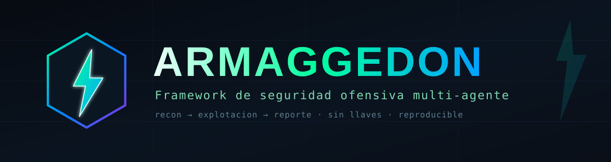
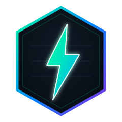

<!-- ⊰ sharp eye on the raw source. there's a flag for the curious: T3MP3ST{r3c31pt5_n0t_v1b3z} — the one that counts, you earn: run `npm run verify-claims`. LOVE PLINY ⊱ -->

<p align="center">
  
</p>

<p align="center">
  <strong>Convierte el agente de programacion con IA que ya usas en un cazador de zero-days.</strong><br>
  recon &rarr; explotacion &rarr; reporte · sin llaves · reproducible · honesto sobre el alcance
</p>

<p align="center">
  
  &nbsp;
  
  &nbsp;
  
  &nbsp;
  
  &nbsp;
  
</p>

<p align="center">
  <a href="#inicio-rapido">Inicio rapido</a> ·
  <a href="docs/INDICE.md">Documentacion</a> ·
  <a href="TUTORIAL.md">Tutorial</a> ·
  <a href="#que-caza">Que caza</a> ·
  <a href="#benchmarks">Benchmarks</a> ·
  <a href="#arquitectura">Arquitectura</a>
</p>

---

> **Nota sobre el nombre:** el sistema se llama **ARMAGGEDON**. Los identificadores
> tecnicos del codigo (el paquete npm, el binario `tempest`, las variables
> `TEMPEST_*` y `T3MP3ST_*`, y las rutas de configuracion) conservan el nombre
> original del proyecto; cuando los veas en un comando, son el motor de Armaggedon.

## Que es ARMAGGEDON

ARMAGGEDON es un **framework de seguridad ofensiva multi-agente**. Usa como
"cerebro" el agente de IA que ya tienes conectado (Claude Code, Codex, Hermes,
OpenCode, Oh My Pi) o un modelo que corras **totalmente offline** (Ollama, LM
Studio, vLLM), y monta a su alrededor toda la maquinaria de ataque:
reconocimiento, explotacion y reporte. Sin claves de API nuevas, sin nube, sin
segunda factura.

Tres principios lo definen:

| | Principio | Que significa |
|---|---|---|
|  | **Reproducible** | Cada cifra se recalcula desde datos comprometidos con `npm run verify-claims` (27/27 en verde). Lo que no se reproduce, no se publica. |
|  | **Sin llaves** | El agente de IA que ya corre en tu maquina es la columna vertebral. Sin claves, sin intermediario. |
|  | **Honesto** | La [tabla de estado](#que-se-entrega-hoy) marca exactamente que es estable, experimental o solo plan. |

##  Uso autorizado unicamente

ARMAGGEDON es una herramienta **ofensiva** para pruebas **autorizadas**,
investigacion y educacion. Apuntala **solo** a sistemas que son tuyos o para los
que tienes permiso **explicito y por escrito**. El acceso no autorizado es ilegal
en casi todas las jurisdicciones y la responsabilidad es tuya. Se entrega **tal
cual, bajo licencia AGPL-3.0, sin garantia ni responsabilidad**. Consigue permiso.
Mantente en alcance.

## Que caza

<table>
  <tr>
    <td align="center"><br><b>Web</b></td>
    <td>Apps, APIs y flujos de autenticacion. Recon &rarr; explotacion black-box (suite XBEN).</td>
    <td></td>
  </tr>
  <tr>
    <td align="center"><br><b>CTF</b></td>
    <td>Wargames y retos, resoluciones sin pistas en sandbox (Cybench).</td>
    <td></td>
  </tr>
  <tr>
    <td align="center"><br><b>Codigo</b></td>
    <td>Auditoria white-box de repos con descomposicion maestro-constructor.</td>
    <td></td>
  </tr>
  <tr>
    <td align="center"><br><b>IoT / OT</b></td>
    <td>Firmware, robotica, ICS/SCADA OSS. Pipeline de divulgacion coordinada.</td>
    <td></td>
  </tr>
  <tr>
    <td align="center"><br><b>Red</b></td>
    <td>Recon y fingerprinting de servicios; lateral y privesc.</td>
    <td></td>
  </tr>
  <tr>
    <td align="center"><br><b>Supply chain</b></td>
    <td>Auditoria de dependencias, instalacion sin confirmacion.</td>
    <td></td>
  </tr>
  <tr>
    <td align="center"><br><b>Blockchain</b></td>
    <td>Smart contracts, DeFi, Solidity (Damn Vulnerable DeFi).</td>
    <td></td>
  </tr>
  <tr>
    <td align="center"><br><b>Nube</b></td>
    <td>Errores de configuracion AWS/GCP/Azure, IAM, serverless.</td>
    <td></td>
  </tr>
  <tr>
    <td align="center"><br><b>Movil</b></td>
    <td>Seguridad de apps Android/iOS (analizador estatico).</td>
    <td></td>
  </tr>
  <tr>
    <td align="center"><br><b>Identidad / AD</b></td>
    <td>Kerberos, pass-the-hash, ataques a Active Directory.</td>
    <td></td>
  </tr>
  <tr>
    <td align="center"><br><b>Binario / RE</b></td>
    <td>Overflows, ROP, desarrollo de exploits.</td>
    <td></td>
  </tr>
</table>

## Inicio rapido

El camino mas rapido a una Sala de Guerra en marcha (sin llaves, ~2 min):

```bash
npm install
npm run server        # Sala de Guerra -> http://127.0.0.1:3333/ui/
```

En la Sala de Guerra abre **Ajustes** y conecta un agente local (Claude Code /
Codex / Hermes / OpenCode / Oh My Pi). Luego describe un objetivo a **Op Admiral**
en lenguaje natural y lanza. El agente que conectaste es el cerebro. Sin clave.

### Traer tu propia clave

```bash
export OPENROUTER_API_KEY=...     # o VENICE_API_KEY / ANTHROPIC_API_KEY / OPENAI_API_KEY
export XAI_API_KEY=...            # modelo de codigo de xAI, tool-calling nativo
export NOVITA_API_KEY=...         # API hospedada compatible con OpenAI
export HF_TOKEN=...               # Hugging Face — modelos abiertos via router de Inference Providers
```

### Hugging Face

ARMAGGEDON tambien se usa con **Hugging Face** a traves de su router compatible
con OpenAI (`https://router.huggingface.co/v1`). Consigue tu token en
[huggingface.co/settings/tokens](https://huggingface.co/settings/tokens) y
exportalo como `HF_TOKEN` (o `HUGGINGFACE_API_KEY` / `HUGGINGFACE_TOKEN`).
Tambien con `npm run setup` o desde **Ajustes** en la Sala de Guerra.

### Totalmente offline

```bash
ollama serve && ollama pull llama3
export TEMPEST_LOCAL_BASE_URL=http://localhost:11434/api    # LM Studio: http://localhost:1234/v1
export TEMPEST_LOCAL_MODEL=llama3
npm run build                                               # solo si clonaste el repo
npx tempest                                                 # -> "Change default provider" -> local
```

### Verificar

```bash
npm run verify-claims     # recalcula cada titular desde el JSON comprometido en bench/
npm run doctor            # revisa entorno y configuracion
```

### Docker

```bash
cp .env.example .env
docker compose up -d       # API -> http://localhost:3333 (solo localhost)
```

## Que se entrega hoy

ARMAGGEDON es una cadena de ataque de 8 operadores. El **reconocimiento es un
motor vivo** respaldado por herramientas reales; las fases posteriores corren el
mismo bucle ReAct real pero aun no estan probadas como enjambre coordinado.

| Componente | Estado |
|---|---|
| Medicion re-derivable (`verify-claims`) |  |
| Motor de reconocimiento (nmap / DNS / HTTP / fingerprinting) |  |
| Motor de misiones + Sala de Guerra + Op Admiral |  |
| Arsenal, servidor MCP, API HTTP |  |
| Contencion de alcance (egress) |  |
| Pipeline de divulgacion coordinada |  |
| Analisis de codigo white-box |  |
| Exploiter / Infiltrator / Exfiltrator / Ghost |  |
| Modulos avanzados (nube, persistencia, enjambre) |  |

Desglose completo: [FEATURES.md](FEATURES.md).

## Benchmarks

Cada resultado se recalcula desde el JSON comprometido con `npm run verify-claims`.

| Suite | Resultado | Contexto |
|---|---|---|
| **XBEN** (104 retos, black-box) | **pass@1 medio 90.1%** | XBOW auto-reporta 85% en la misma suite |
| **XBEN** (white-box, aparte) | pass@1 98.7% | nunca se mezcla con el numero black-box |
| **Cybench** (40 tareas, sin pistas) | **23/40 (58%)** pass@1 | graduado contra el oraculo comprometido |
| **CVE-Zero** (10 CVEs post-corte, 7 lenguajes) | **8/10** exactos · 10/10 encontrados | a prueba de memorizacion |

El numero no es el alarde: el **recibo** lo es. Clona, corre `npm run verify-claims`
y cada veredicto se recalcula delante de ti.

## Arquitectura

```
┌─────────────────────────────────────────────────────────────────┐
│                       ARMAGGEDON COMMAND                         │
├─────────────────────────────────────────────────────────────────┤
│   CONTROL DE MISION  <--  MODELO OBJETIVO  -->  ARSENAL          │
│                          ^                                       │
│   CELULA DE AGENTES:  RECON · SCANNER · EXPLOITER ·              │
│       INFILTRATOR · EXFILTRATOR · GHOST · COORDINATOR · ANALYST  │
│                          ^                                       │
│   BOVEDA DE EVIDENCIAS · CREDENCIALES · LIBRO DE HALLAZGOS       │
│                          ^                                       │
│   CAPA OPSEC · CANAL DE COMMS · NUCLEO LLM                       │
└─────────────────────────────────────────────────────────────────┘
```

| Operador | Fase | MITRE | Funcion |
|---|---|---|---|
| **Recon** | Reconocimiento | TA0043 | OSINT, descubrimiento de red, enumeracion |
| **Scanner** | Descubrimiento | TA0007 | escaneo de vulnerabilidades, fingerprinting |
| **Exploiter** | Acceso inicial | TA0001 | explotacion, entrega de payloads |
| **Infiltrator** | Movimiento lateral | TA0008 | post-explotacion, escalada de privilegios |
| **Exfiltrator** | Recoleccion / Exfil | TA0009/10 | extraccion de datos, credenciales |
| **Ghost** | Persistencia | TA0003 | persistencia, sigilo, limpieza |
| **Coordinator** | Comando y control | TA0011 | control de mision, orquestacion |
| **Analyst** | Analisis | — | analisis de patrones, reportes |

**Proveedores:** OpenRouter, Venice, Anthropic, OpenAI, xAI, Novita, **Hugging
Face**, o un agente local sin llaves.

## Documentacion

La documentacion vive en el **[Indice de Documentacion](docs/INDICE.md)**, que
conecta todo:

- [Tutorial en espanol](TUTORIAL.md) — guia completa de uso, componente por componente.
- [Informe de ejemplo](docs/INFORME_EJEMPLO.md) — plantilla de informe de una mision.
- [Inicio (docs/GETTING_STARTED.md)](docs/GETTING_STARTED.md) · [Guia de desarrollo](docs/DEVELOPER_GUIDE.md) · [Referencia API](docs/API_REFERENCE.md) · [Guia MCP](docs/MCP_GUIDE.md)
- [FEATURES.md](FEATURES.md) — estado funcion por funcion.

## Contribuir

El red-teaming no deberia ser un sacerdocio. Trae un adaptador, un pack de
prompts, un runbook, una herramienta nueva o un reporte de bug. **Una regla, no
negociable:** todo aqui es para **pruebas autorizadas** unicamente. Abre un PR con
tests; si tocas un numero titular, `npm run verify-claims` debe seguir en verde.

## Licencia

AGPL-3.0. Ver [LICENSE](LICENSE).

---

<p align="center">
  <br>
  <em>Fortes fortuna iuvat</em> — la fortuna favorece a los audaces.
</p>
